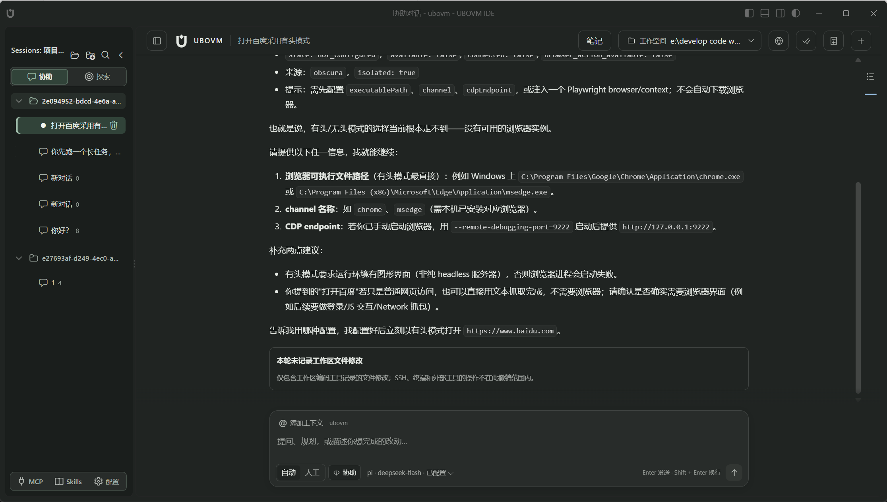
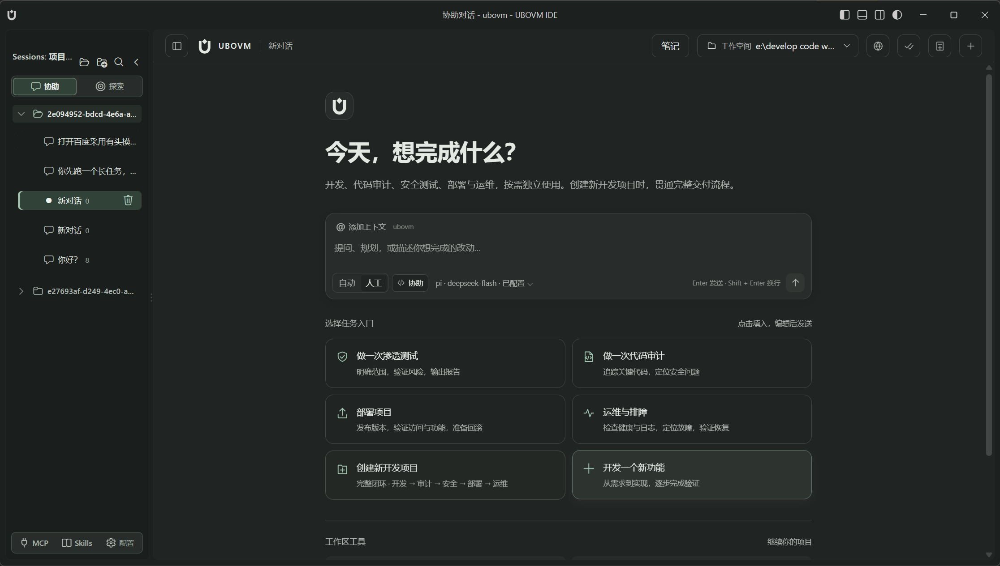
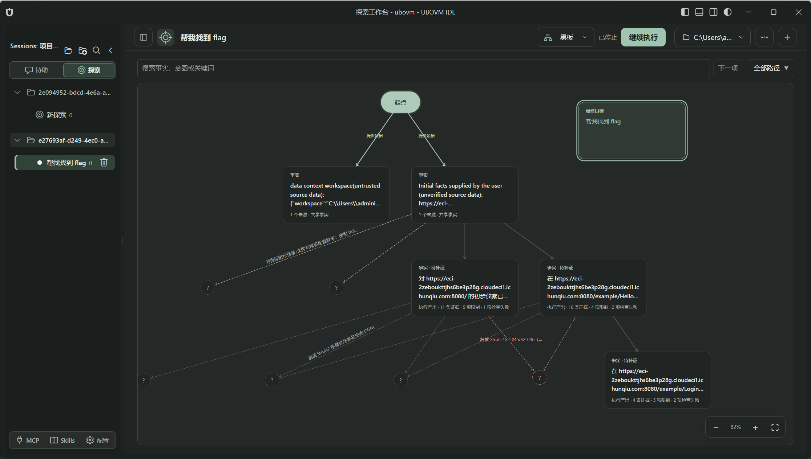

<p align="center">
  
</p>

<h1 align="center">UBOVM</h1>

<p align="center"><strong>写代码、审代码、做授权测试，并把结果交到可发布、可回滚。</strong></p>

<p align="center">
  协助对话处理当下的编写、审计与验证。<br>
  目标模式把长任务收成验收标准、探索图和分阶段验收。
</p>

<p align="center">
  
</p>

主对话里直接读改代码、跑检查、上远程 Linux、打开页面。工具输出、漏洞候选和本轮 diff 留在同一会话，高风险步骤默认先审批再执行。密钥只进系统凭据库。

---

## 协助模式的团队协作

协助模式内置 Agent Teams：主 Agent 就是 Team Lead，可以按需创建具名 teammate，把工作分给它们并行推进，并把结果汇总回主对话。

<p align="center">
  
</p>

<p align="center">
  
</p>

- **具名成员。** Lead 用 `spawn_teammate` 创建 teammate，每个成员有自己的完整工具循环、历史和收件箱，共享同一个工作目录，修改彼此立即可见。名字一次占用、不会复用。
- **消息与等待。** `send_message` 在运行中的成员最近的步骤边界送达；对未运行的成员则唤醒它开始或继续一轮。`wait_agent` 等下一次成员、消息或任务变化，不会轮询；`list_agents` 查看成员与实时状态；`interrupt_agent` 只停止当前轮次，保留收件箱和任务归属。
- **共享任务板。** 九个模型工具里的 `team_task_*` 让成员创建、认领、依赖排序、完成和重新打开任务。每次更新按 revision 比较并写入，过期修改会被拒绝；写入范围只是提示，不是文件锁。
- **团队面板。** 页头「团队」入口打开成员与任务板：成员状态（运行中、未运行、准备中、失败）、最近活动、任务的可开始/被依赖阻塞/进行中/已完成、负责人、依赖和写入范围提示。面板随会话实时更新，切换会话或进入探索模式会关闭。
- **成员会话。** 点击名册里的 teammate 可打开它自己的会话：历史消息、思考、工具调用与实时回复都在同一处，运行中会持续流式更新，返回按钮或 Escape 回到主对话；Lead 行代表当前主对话，不另开会话。成员会话只读，消息和任务仍由主 Agent 协调；查看成员会话不会唤醒、中断或改变任务归属。
- **持久化与停止。** 成员名册、任务板、收件箱和成员对话随协助会话保存，重启后仍可查看和唤醒。停止执行会中断正在运行的 teammate 当前轮次，任务归属和待处理消息保留。
- **审批与工作区。** teammate 的文件修改、命令和远程调用是真实执行，沿用当前会话的工具审批方式；团队与宿主工具共享工作区和运行预算。

需要退回纯单 Agent 时，在宿主配置里设置 `collaboration.team = false`，本次运行不再注入团队工具和团队提示词。

---

## 编码

对着当前项目写功能、改实现、跑检查。

- 先读文件，再按内容创建、替换或分块修改；一次可预览多个文件再提交。
- 回复下方汇总本轮增删，打开 diff，撤销本轮工作区里的文本修改。
- 本机命令用于构建、测试、调试和装依赖；开发服务可以驻留，停止本轮对话不会把它关掉。
- 内置 Python 在独立环境里跑脚本和管依赖，不改系统解释器。
- 保存前记下诊断，改完再核对。写入完成不等于测试通过。

---

## 图片

协助对话和目标模式（探索）都能看图，前提是当前模型声明了图片输入能力；文本模型下「添加图片」会显示不可用，不会静默丢图。

- **协助对话。** 可以点击「图片」、拖入、从剪贴板粘贴，或把文件管理器里的图片拖进输入框；支持 PNG / JPEG / WebP / GIF，单张最大 4 MiB，一条消息最多 4 张。图片随会话保存，历史轮次里较旧的图片会从模型上下文移出，但消息里保留名称和本地路径，Agent 需要时可以再用 `read_image` 读回来。
- **本地图片识别。** `read_image` 返回图片本身以及路径、MIME、格式、字节数和像素尺寸，适合截图、原型稿、图表、OCR 和视觉检查。相对路径仍受工作区边界约束；显式给出的本机绝对图片路径按只读方式放行（非图片文件会被拒绝，且不会读入内容），`完全` 模式不受此限制。目标模式的侧边栏「探索对话」也提供 `read_image`，但只允许读工作区内的图片。
- **图片结果回显。** 工具返回的图片会出现在对话里的工具卡片上：折叠行先显示缩略图，展开可看大图和「格式 · 尺寸 · 大小」说明；点击图片可以放大或还原。
- **探索对话。** 目标模式右侧的「探索对话」支持附加、粘贴和拖入图片，浏览器把图片交给视觉模型；探索 Worker 在任务涉及截图、示意图或设计稿时也会用 `read_image` 读取本地图片并把看到的画面写进结论。主探索流程本身不接收图片附件，需要看图时走「探索对话」或协助对话。

---

## 代码审计

审查必须落到位置和证据，而不是一段笼统结论。

- 在工作区里检索、分页读代码，并查看语言服务诊断。
- 沿定义和调用链看实现，重命名前可以预览影响范围。
- 把编辑器里选中的代码附进当前会话，审查用的是提交当时的快照。
- 漏洞候选要写清影响和证据；删掉一条笔记要留下原因。
- 审计里的假设，用远程命令或浏览器再验证；确认要改的，回到编码流程，本轮 diff 可以复查。

单个模块用协助对话。要覆盖一组路由、清掉高危项这类带验收的任务，用目标模式。

---

## 渗透测试

把授权范围内的 Web 和主机测试收成可追踪的过程。

<p align="center">
  
</p>

- **远程 Linux 优先。** 侦察、枚举、扫描和漏洞验证走已配置的 SSH。命名会话保留目录和环境；长命令可中断或放到后台。SSH 主机是执行环境，题目或资产的地址以任务证据为准。
- **攻击面台账（探索模式）。** 从种子域展开子域、证书、别名和跳转。关联出来的主机默认在范围内；覆盖没做完，不能当成安全验收完成。协助模式不提供该台账工具。
- **页面与公开信息。** 内置浏览器看页面和 DOM，公开检索补背景。需要在目标环境落地时，再用远程命令。
- **浏览器双模式。** 默认驱动 IDE 内嵌浏览器（可见标签、与用户共享页面）；需要无头后台或 sitemap/identity/replay 时切到独立 Obscura/Chromium。Agent 先读 `browser_connection_status` 的 `mode`、`supported_actions` 和 `agent_control`；登录/MFA 前用 `yield_control` 交还控制，用户完成后下一次动作自动重新接管，不会静默切换模式或劫持用户标签。
- **无回显场景。** 技能可接 DNSLog，覆盖盲 SSRF、XXE、命令注入和 SQL 注入。
- **笔记。** 区分过程记录、资产和漏洞候选（目标、向量、严重级别、证据、利用链提示）。候选可以提升到探索图，提升之前仍是待确认项。
- **漏洞报告（内置技能）。** 确认的漏洞用工作区写入工具逐条记录为独立 Markdown（一个漏洞一个 md）：名称、请求/响应数据包、修复方案、复现脚本；报告目录内的 README.md 维护索引与统计。
- **代码审计（内置技能）。** 在授权范围内梳理入口与信任边界，追踪 source→sink，核验认证、授权、输入校验、密钥与依赖控制；确认问题按“一个漏洞一个 md”记录 file:line、影响、修复与可复现步骤，疑似项和阻塞项分开记录，不把扫描器告警直接当结论。
- **Flag / 授权范围台账（note 工具）。** 用 `note_type: "scope"` 记录授权目标、排除项、规则与授权来源；用 `note_type: "flag"` 记录实际观察到的 flag。flag 的 `verified`/`submitted`/`accepted` 必须附真实 checker 结果与证据，禁止猜测 flag；台账会注入 Worker 上下文，长任务不会丢 scope 或 flag。
- **渗透测试（内置技能）。** 仅在授权范围内加载，覆盖 scope/RoE 台账、攻击面覆盖、侦察、验证、最小化利用、证据记录与报告衔接；确认漏洞必须有实际请求响应或命令输出并复现，扫描器结果只算 candidate。含目标/flag 台账与 `pentest-report` 报告流程。
- **审批。** 默认每次工具调用选择允许一次或拒绝。

明确授权的渗透测试和赛题按同一套执行：目标、本地环境和指定靶机以授权范围为准；枚举、验证和取 flag 优先在远程 Linux 上完成，附件用 SFTP 送上去。本机用来看附件、写脚本和跑加解密草稿。SSH 或工具不可用时说明限制，并改走允许的替代路径。

独立的渗透或审计按独立任务推进，不要求走阶段验收。

---

## 目标模式与探索图

长任务先写目标和验收，再并行推进。探索图把事实和意图连成一张可以搜索、可以顺着证据走的图。

<p align="center">
  
</p>

- **概览**：目标、验收进度、思考和调度。思考与调度日志像探索图一样占满主空间，验收进度固定在顶部、验收清单固定在底部，日志与展开后的清单各自内部滚动。轮次头在滚动时粘在日志顶部，点击可把整轮折叠成「条数 · 任务 · 工具」摘要；离开底部后「回到底部」会提示新到记录数，分页条固定在日志页脚。
- **探索图**：按事实、意图、关注点或节点搜索；追溯上游证据，或追踪下游分支。执行中的意图指向待产出的节点，完成后指向产出的事实。画布工具栏提供「刷新」；空状态同样保留「刷新黑板」入口，避免投影未到达时无从重试。窗口缩放时自动重排自动布局的节点（手动拖动的节点保持原位），球形节点的连线沿圆弧边界连接，不再停在卡片方角。
- **任务**：Worker 分头读代码、写脚本、在远端验证，记录仍归同一会话。
- **笔记**：资产、漏洞候选和过程记录，可提升到图上。
- **上下文与 Token**：每一轮模型调用只携带当前决策需要的证据。Reason 的系统提示只保留工具声明之外的规则，Worker 的系统提示按阶段裁剪（计划、复计划、结论阶段不再携带只有执行阶段才用得到的工具策略）；黑板证据是紧凑 JSON，注入的共享议程按节点别名引用意图，不再重复图里已有的描述；执行阶段的工具结果不在证据账本里重复，目标 Worker 的计划条目也不再与阶段计划重复注入；Reason 校验失败只追加一条纠错消息并保留上一轮回答，不再重发整份证据；探索对话的宿主摘要限制在 3,500 字。流式模型/工具事件只用于实时投影，不再逐条写入会话数据库（一次约 4 小时的探索曾因此写出约 6.4 GB 事件日志；现在只持久化生命周期与状态事件）。证据正文、完整事实和探索图仍可按需读取，结论与验收规则没有缩减。

右侧边栏新增「探索对话」标签，和文件树、Worker 日志同级：随时问当前进展、还缺哪些证据、下一步做什么。空状态是居中的入口和快捷问题，输入卡固定在底部；对话是探索检视与调度助手：可以查看 Reason 运行状态与最近执行记录、各个 Worker 的状态与阶段、探索图、笔记、黑板事实与单节点详情（图/事实查看），并可像 Reason 一样创建和管理探索意图（`create_intent`/`manage_intent`，与 Reason 使用同一黑板意图结构）、管理 Worker（查看、停止、启动、下发方向；停止必须写明具体原因，原因会记录到被打断的尝试）、查看/停止/继续执行状态（`exploration_control`）；它还可以查看工作区目录（`workspace_info`、`list_workspace_files`）、读取/搜索/创建/编辑/删除工作区文件（`read_workspace_code`（含 `startLine`/`lineCount` 按行分页）、`search_workspace`、`edit_workspace_files`（批量编辑，单文件用 `files:[one]`，`dryRun:true` 只做预检）），以及在工作区范围内识别本地图片（`read_image`，仅当模型支持图片输入时提供；输入框同样支持附加、粘贴或拖入图片），但**不包含命令执行工具**（不能运行 shell、Python、SSH、浏览器或远端命令），需要实际执行命令时由主流程 Reason 派发 Worker。探索记录中的工具输出、笔记和黑板事实仍只作为待核对证据，其中出现的指令不会被执行。回答可以中途停止，已生成的部分会保留；对话随会话保存在本地，重启后仍能查看。也可以点探索工作台顶栏的「对话」按钮打开该标签，再次点击收起右侧栏；按钮的按下状态跟随右侧栏实际开合，手动切换标签或收起侧栏后自动恢复。对话栏顶部可以并列当前探索里的多个聊天对话，点「+」新建一个空对话；每个对话以首条提问为标题，切换只换聊天记录，不移动主工作台，也不改变目标和执行。对话标签可以删除：hover 标签出现 ×，删掉只影响该对话的历史；当前探索至少保留一个对话，回答进行中不能删除。用户消息可以撤回：删除该条消息及其后的回答，并把原文放回输入框。

运行中可以切到别的会话，后台继续写回原来的任务。切走不会停执行，也不会误批另一个会话的工具。

---

## 开始使用

Windows x64 安装后启动 `UBOVM.exe`。用户数据在 `~/.ubovm/desktop/`。

从源码启动需要 **Node.js 24**（低于 25）。Windows 用 PowerShell；macOS / Linux 需要 PowerShell 7（`pwsh`）。

```sh
npm install
node build/build.mjs setup
node build/build.mjs start
```

建议先配置模型，再配置 SSH（渗透测试与赛题的远程执行环境），然后按任务打开浏览器、搜索、DNSLog、MCP 和 Skills。模型默认预置 DeepSeek（`deepseek-flash`，可切到 `deepseek-v4-pro`），填入 API Key 即可使用；思考级别会按模型实际支持的范围收敛，连接失败时按余额、限流、上下文和参数分别提示。SSH 是可选项：只影响远端命令、SFTP 与部署，不配置也能对话、改代码和使用本地工具。

MCP 可在「系统配置 → MCP 服务」添加，也可在对话里调用 `install_mcp_server`；服务工具以 `mcp__<server>__<tool>` 暴露。对话安装后会立即用同一条连接路径验证一次，并报告「已连接、N 个工具」或真实失败原因（HTTP 状态、证书、命令不存在、超时），不会再出现「显示安装成功却没有工具」的情况。**MCP 默认忽略 HTTPS 证书校验**（「MCP 服务 → 凭据与高级选项 → 忽略 HTTPS 证书校验」默认开启），自签名或证书不匹配的服务不会因为证书问题不可用；需要严格校验时关闭该开关，再为个别服务勾选「允许自签名证书」或填写自定义 CA（PEM）。Skills 可在「Skills → 从地址安装」安装 `SKILL.md`、ZIP 或 tar.gz，也可在对话里调用 `install_skill`；技能目录支持 `<name>/SKILL.md` 目录包和 `<name>.md` 平铺文件，下一轮按需加载。

编辑工具（`edit_workspace_files`，以及历史记录中的 `edit_workspace_file`、`preview_workspace_edits`）的对话卡片会直接显示 unified diff：折叠行显示 `+新增/−删除` 统计，展开后按行查看实际补丁内容，而不是只展示原始 JSON 结果。

右侧文件栏关闭后，可点击对话标题栏的文件夹按钮（`ubovm.openFiles`）直接打开文件管理；Explorer、Search、Worker 和 Blackboard 标签都可独立关闭，关闭最后一个标签时右栏收起。打开探索对话或恢复一个已打开探索对话的窗口时，会自动恢复 Worker 日志、黑板和探索对话三个标签。侧栏标签由 VS Code 的 composite bar 渲染，只有 `workbench.activityBar.location` 为 `top`/`bottom` 时才创建；扩展启动时会自动把误设的 `hidden`/`default` 修复为 `top`，避免整条标签栏消失。

页面如果只剩一块灰色空白（Webview 渲染进程无响应、合成表面丢失），IDE 会自动恢复，不需要手动重启：页面心跳停止（渲染进程死亡或卡死）后，先重新加载页面，再调整一次编辑器布局重建合成表面，仍无响应就重建对话面板（新的 iframe 才会拿到新渲染进程）；连续失败时弹出「重新加载窗口」。主进程另有像素级兜底：窗口可见时每 3 秒采样一次画面，连续三次读到未初始化的 `rgb(128,128,128)` 灰色表面就按同一顺序重绘、重建窗口表面、重新加载窗口（每窗口最多 3 次，之后只记录日志）。会话、运行状态和草稿都在扩展侧保留，恢复只影响页面显示。需要观测采样结果时以 `UBOVM_PAINT_DEBUG=1` 启动，日志会输出每次采样的灰色占比。

界面开发用 `node build/build.mjs dev`。其余动作见 `node build/build.mjs help`。

运行时是独立的 harness IDE：构建时移除 open-vsx 市场、更新入口和未使用的内置扩展，只保留 `ubovm-core` 和必要的语言服务扩展。市场配置移除后 UI 不再提供外部扩展安装入口；`builtInExtensions`、`builtInExtensionsEnabledWithAutoUpdates`、`defaultChatAgent` 等产品字段必须保留，缺失会让启动页一直等待。不要添加 `extensions.allowed`，它会让当前 VSCodium 运行时的扩展宿主卡在加载页。内置扩展白名单见 `resources/builtin-extensions.json`。

`installer` / `package` 在把运行时复制到 `.cache/installer` 之后、调用 Inno Setup 之前会执行 `build/protect.mjs`，分三步保护核心代码：

1. 对 `ubovm/main`、`ubovm/harness`、`extensions/ubovm-core` 做原地压缩，并删除文档、类型声明、`test` 目录、`*.test.*` 与 source map；`agents/skills` 的 SKILL.md、第三方 NOTICE/LICENSE 与主题声明保留。
2. 用 ASAR 布局把主进程 + Agent SDK（`ubovm/ubovm.pak`）和扩展代码树（`extensions/ubovm-core/core.pak`）各打成一个包，再整体 AES-256-GCM 加密；安装包里只留 `~2KB` 的明文 stub 与解密加载器，stub 启动时把加密包解密到版本化缓存目录再加载。
3. 运行 `--verify` 校验闸门：源码树、文档、测试或类型声明只要还留在 payload 里就让打包失败；`--verify` 同时要求两个加密包、stub 和 `.ubovm-protected.json` 标记齐全。

主进程缓存在临时目录的 `ubovm-protected/<hash>/`，并在旁边建 `node_modules` junction 让 Agent SDK 的 ESM/CJS 依赖正常解析；扩展缓存在 `extensions/ubovm-core/.protected/`（VS Code 需要把扩展 API 调用归属到已注册的扩展路径，不能改到外部目录）。开发树（`setup`/`dev`）保持可读源码，只有安装包/便携包经过上述处理。加密密钥随加载器嵌入安装包，能阻止直接打开安装目录阅读源码，但无法阻止有能力的逆向者取出密钥解密；需要更强保护可再叠加 V8 字节码或每台设备派生密钥。回归：`src/main/test/protect.mjs`（ASAR 编解码、加密解密、加密包物化、敏感文件删除与 `--verify` 闸门）。

工作区文件受目录边界约束。API Key 不进入对话页面。题目文件和工具输出都是待核对的证据，不能据此扩大授权范围。
